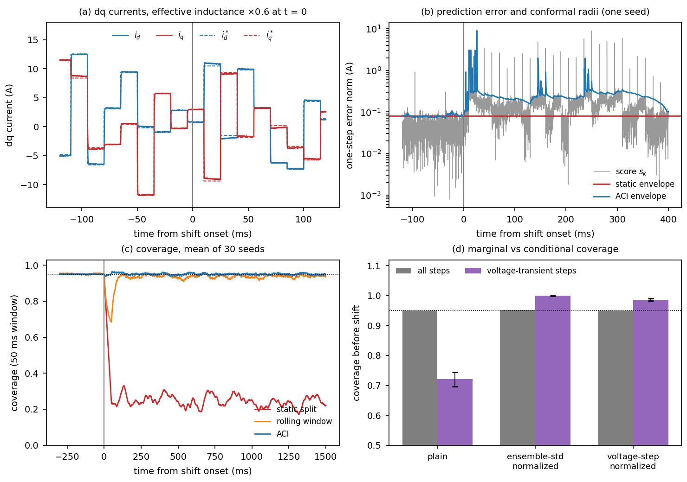

# uq-adaptive-safety-pilot

Pilot study for the research plan *"Uncertainty-Aware Adaptive Safety for Learning-Enabled Autonomous Systems"* (revised Phase II I-TRIP, Eric and Wendy Schmidt AI in Science African Faculty Fellowship).

It asks one question in simulation: **when a learned model sits inside a feedback loop and the plant shifts, how well do online conformal prediction intervals keep their coverage, how wide do they get, and how quickly can a monitor tell that they have stopped being valid?**

> **Scope, stated plainly.** Everything here uses small, author-built toy models. It is **not** the host laboratory's model, **not** real flight data, and **not** evidence about a deployed system. It supports the *calibration and monitoring* parts of the plan (hypotheses H1 and H2 in the I-TRIP). It does **not** test the adaptive controller, the barrier filter, or the stability theorems.

---

## 1. Headline results

All numbers come from the logs in `results/`. Coverage target is 0.95 (alpha = 0.05). Mean over seeds; "later" means after the first 10 s (UAV) or 0.1 s (converter) following the shift.

### UAV loop (primary plant): thrust effectiveness drops 1.0 -> 0.79 (the air-density ratio at about 2,350 m)
30 seeds. Log: `results/uav_run_plain79_log.txt`.

| Calibrator | Coverage before shift | Coverage, first 10 s after | Coverage, later | Mean width after (nominal 0.0437) |
|---|---|---|---|---|
| Static split conformal | 0.949 | 0.568 | 0.618 | 0.0437 (fixed) |
| Rolling-window conformal | 0.952 | 0.801 | 0.948 | 0.0840 (1.9x) |
| Adaptive conformal inference (ACI) | 0.950 | 0.939 | 0.951 | 0.0817 (1.9x) |

- ACI windowed (2 s) coverage returns to >= 0.90 within about 2.2 s (mean trace).
- Block-to-block coverage std (2 s blocks, before shift) is 0.051 versus 0.034 if samples were independent, i.e. an effective sample size of roughly 44%: the gusts make the scores dependent.
- Learned residual cuts mean one-step error 5.5x (0.122 -> 0.022 m/s); see `results/uav_train_log.txt`.

**Monitor detection delay** (thresholds set on a separate 60,000-step nominal run to allow at most one alarm event per 10^4 steps; alarm needs 5 consecutive steps above threshold):

| Statistic | Detected | Median delay | 95th pct | False alarms per 10^4 steps (out of sample) |
|---|---|---|---|---|
| S1: exceedance rate of a *frozen* reference envelope | 30/30 | 0.80 s | 1.08 s | about 1.3 |
| S2: drop of ACI's alpha_k below target | 30/30 | 0.73 s | 7.4 s | about 1.0 |
| Exceedance rate of ACI's *own* intervals | 30/30 | 18.95 s (IQR 0.9-25.9) | 46.7 s | about 1.2 |

ACI keeps its own coverage near target by design, so that coverage is a poor alarm signal. This is the reason the monitor uses S1/S2.

**Normalizing the score by the commanded acceleration hides the shift** (`results/uav_run_norm79_log.txt`): the shift enters through the commanded acceleration, so dividing by it removes the signature. Frozen-envelope detection then takes a median 82.6 s and misses 3 of 30 runs. Design rule: do not normalize by the quantity through which the shift enters.

### Simplified dq inverter current loop (transfer plant), 30 seeds, effective inductance x0.6 (`results/converter_run_derate_log.txt`)

| Calibrator | Coverage before | First 0.1 s after | Later | Width after (nominal 0.079) |
|---|---|---|---|---|
| Static | 0.950 | 0.239 | 0.246 | 0.079 |
| Rolling | 0.951 | 0.811 | 0.938 | 0.274 (3.5x) |
| ACI | 0.950 | 0.957 | 0.950 | 0.282 (3.6x) |



*Figure (`figures/fig_converter.png`, made by `scripts/make_figure_converter.py`). (a) dq currents and references in one run around the x0.6 inductance shift: tracking stays good. (b) The model's one-step prediction error jumps after the shift; the static envelope (red) is then exceeded constantly while the ACI envelope (blue) grows, with brief spikes to the window maximum. (c) Coverage over time, mean of 30 seeds. (d) Marginal versus voltage-transient coverage before the shift, for three score definitions.*

Inductance x1.5 (a crude stand-in for a weaker grid; the point-of-connection voltage stays constant, so this is a parameter change, not a grid model), 20 seeds (`results/converter_run_weak_log.txt`): static later coverage 0.207, ACI 0.950 (width 0.336 versus 0.079).

**Marginal coverage can hide conditional undercoverage** (`results/converter_normalization_log.txt`, 20 seeds): with the plain score, overall coverage is 0.951 but coverage on voltage-transient steps is only 0.72. Normalizing by the commanded voltage step (physics-informed) gives 0.987 on transients at mean radius 0.084 versus 0.079; normalizing by ensemble standard deviation gives 1.000 at 0.092. Conditional coverage is **plant-dependent**: on the UAV loop, plain-score coverage on aggressive-maneuver steps was already 0.935.

---

## 2. What is modelled

### UAV loop (`src/pilot/uav.py`)
Horizontal translational dynamics at 20 Hz (Ts = 0.05 s):

    v[k+1] = v[k] + Ts * ( kappa * a[k] - cd * |v[k]| * v[k] + w[k] )
    w = Ornstein-Uhlenbeck gust (tau = 1 s, sigma = 0.25 m/s^2)
    a[k] = clip( Kp*(p_ref - p) - Kd*v_meas ),  waypoints change every 6 s
    nominal model:  v_hat[k+1] = v[k] + Ts * a[k]       (no drag, no gust, kappa = 1)

`kappa` is the thrust effectiveness (1 at training; 0.79 after the shift). A deep ensemble (5 MLPs, 32x32, tanh, bootstrap) learns the residual from (v, a) at kappa = 1. Score `s_k = |v[k+1] - v_hat[k+1]|` (plain) or divided by `1 + |v|/3 + |a|/3` (normalized).

### Inverter current loop (`src/pilot/converter.py`): a simplified model, not a full inverter
dq-frame converter-side current with a saturating inductance:

    L_eff(i) * di/dt = v - e - R*i + w0*L_eff*J*i,    L_eff = kappa * L0 / (1 + beta*|i|^2/Is^2)

A PI controller with decoupling regulates `i` (600 Hz bandwidth, 400 V limit, Ts = 100 microseconds, constant point-of-connection voltage e = (325, 0) V). The learned residual covers the saturation effect; the shift multiplies the effective inductance by `kappa`.

**Not modelled:** LCL/LC filter, DC-link dynamics, PWM/switching, computation or measurement delay, three-phase (abc) model, grid-impedance dynamics, PLL, grid-forming behavior. The model only shows that the calibration pipeline runs on a second plant; the real transfer test uses the host's converter models.

### Calibrators and monitor (`src/pilot/uav.py`, `converter.py`, `common.py`)
- **Static split conformal:** quantile of calibration scores, fixed.
- **Rolling window:** quantile of the last W scores (W = 400 UAV, 1000 converter).
- **ACI:** alpha_{k+1} = alpha_k + gamma*(alpha - err_k), gamma = 0.01; radius = (1 - alpha_k) quantile of the window (window maximum when alpha_k <= 0). Its guarantee is a long-run *average*, not per-step coverage.
- **Monitor (UAV experiment; the converter script uses a simpler fixed-threshold version):** statistics S1 (trailing 40-step exceedance rate of the frozen reference envelope) and S2 (alpha - alpha_k); threshold calibrated on nominal data (`calibrate_threshold`), alarm requires 5 consecutive steps. It is a heuristic trigger; no formal bound is claimed.

---

## 3. Quick start

Requires Python >= 3.10. Tested with Python 3.12, numpy 2.4, scikit-learn 1.8, matplotlib 3.10.

```bash
git clone https://github.com/biniamtgebru/uq-adaptive-safety-pilot.git && cd uq-adaptive-safety-pilot
python -m venv .venv && source .venv/bin/activate
pip install -r requirements.txt

python scripts/smoke_test.py      # roughly a minute (not precisely timed); checks the pipeline and the qualitative result
bash scripts/run_all.sh           # reproduces every number above (about 15-20 min on one CPU core)
```

Or run pieces:

```bash
cd scripts
python uav_train.py                      # trains the UAV ensemble -> artifacts/uav_ensemble.pkl
python uav_run.py 0.79 0 30 plain79      # args: kappa_after_shift  normalized(0/1)  n_seeds  tag
python make_figure.py                    # UAV figure -> figures/fig_pilot.pdf / .png
python converter_train.py                # -> artifacts/converter_model.pkl
python converter_run.py 30 0.6 derate    # args: n_seeds  kappa_after_shift  tag
python converter_normalization.py        # conditional-coverage test of score normalizations
python make_figure_converter.py          # dq inverter figure -> figures/fig_converter.pdf / .png (needs the three converter steps above)
```

---

## 4. Repository layout

```
src/pilot/common.py        MLP ensemble (NumPy inference) and split-conformal helpers
src/pilot/uav.py           UAV loop, scores, ACI/rolling/static calibration, monitor utilities
src/pilot/converter.py     Inverter current loop, calibration experiment, exploratory safety filter
scripts/                   Entry points (see Section 3); _paths.py sets import path and output dirs
results/                   Logs from the runs reported above (plus .npz/.pkl outputs when you re-run)
figures/                   fig_pilot.pdf/.png (UAV), fig_converter.pdf/.png (dq inverter loop)
artifacts/                Trained ensembles (git-ignored; recreated by the train scripts)
.github/workflows/         Optional CI that runs the smoke test (not yet run on GitHub)
```

---

## 5. Reproducibility notes

- All random seeds are fixed (training: 1000 and 2000; test seeds from 5000 UAV, converter likewise). Re-running in this repository layout reproduced the earlier numbers exactly on the machine used.
- scikit-learn's MLP training can differ slightly across library versions and platforms, so expect small deviations (third decimal) rather than bit-identical output on other setups.
- Every test seed uses the same waypoint schedule (changes every 6 s), so the mean coverage trace oscillates in phase with it (see the figure). This is an artifact of the design, not noise.
- One trained ensemble is reused across test seeds; variability from retraining is not measured.

---

## 6. Honest limitations

1. **Toy models, tuned for learnability.** The measurement and process noise levels and the inductance-saturation coefficient were adjusted until the learned residual clearly beat the physics-only model (an earlier setting with larger process noise made the residual unlearnable). Sensitivity to these choices was not explored.
2. **No real data, no hardware.** Results say nothing yet about real flight; the plan validates on high-fidelity simulation, public flight data, then hardware.
3. **Only calibration and monitoring are tested.** The adaptive controller, barrier filter, supervisor and the stability results in the I-TRIP are not exercised here.
4. **The monitor's false-alarm rate was calibrated on one nominal trajectory** and came out slightly above target out of sample (about 1.3 versus 1.0 per 10^4 steps for S1).
5. **Exploratory, inconclusive:** `scripts/converter_safety_filter_exploratory.py` applies a discrete-time current-limit filter with different margins. Even with references pushed close to the limit (17.6 A against 18 A), peak current stayed at about 17.65 A, so the limit never bound and the filter never acted meaningfully (`results/converter_safety_filter_exploratory_log.txt`, 1 seed). **No claim is made from it.** A scenario that stresses the constraint is needed before it says anything.
6. Horizontal-plane UAV only (no vertical axis, no attitude loop, no actuator dynamics).

---

## 7. Using your own data or plant

Replace the simulator with a loader that returns the arrays `(X, Vm, A, Y)` used in `pilot/uav.py::run` (features, measured state, command, next measured state), then reuse `scores`, `calib_exp`, `aci_series`, and `calibrate_threshold` unchanged. To add a calibrator, follow the pattern in `calib_exp` (a loop producing a radius `q_k` and an error indicator `err_k` per step).

---

## 8. Citation

```
Biniam Tadesse Gebru (2026). uq-adaptive-safety-pilot: pilot study of online conformal calibration
and validity monitoring for learning-enabled control loops. Software, https://github.com/biniamtgebru/uq-adaptive-safety-pilot.
```

Methods used: adaptive conformal inference (Gibbs and Candes, NeurIPS 2021), deep ensembles (Lakshminarayanan et al., NeurIPS 2017), conformal prediction beyond exchangeability (Barber et al., Annals of Statistics 2023).

Contact: biniam.tadesse@aau.edu.et
